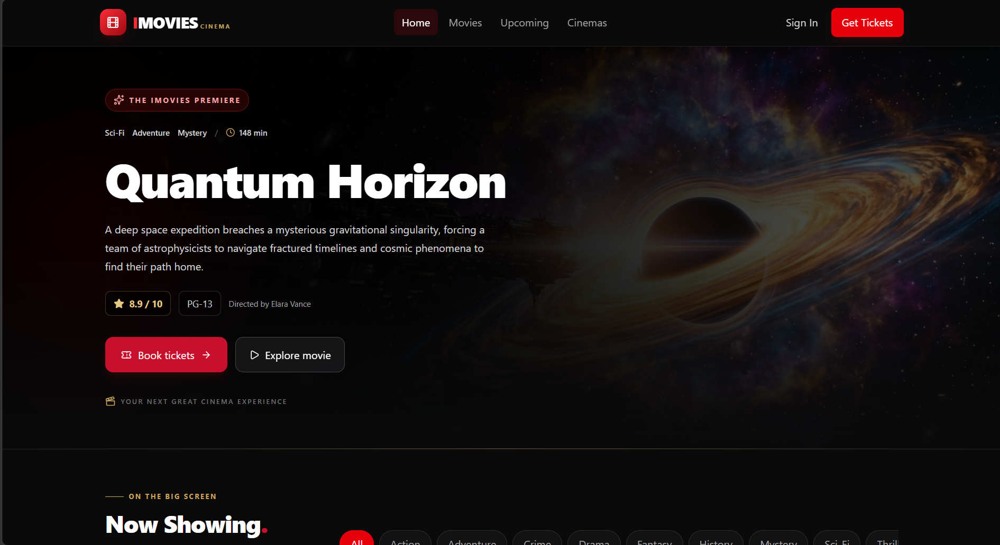
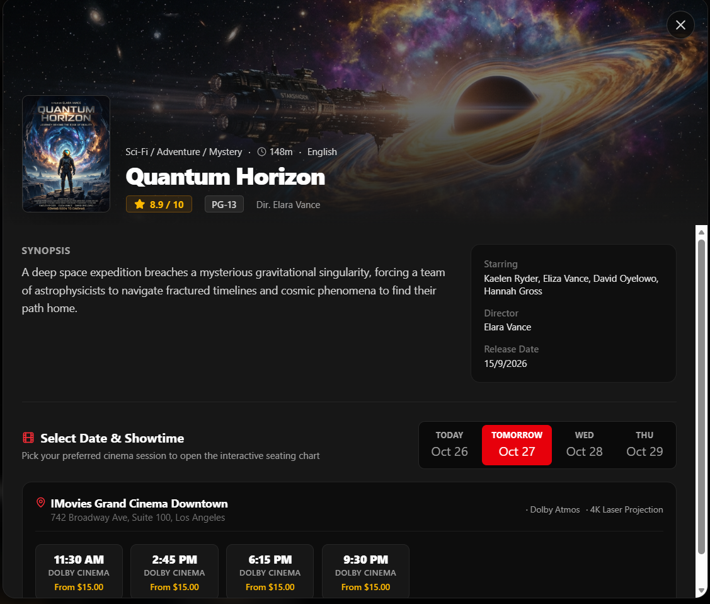
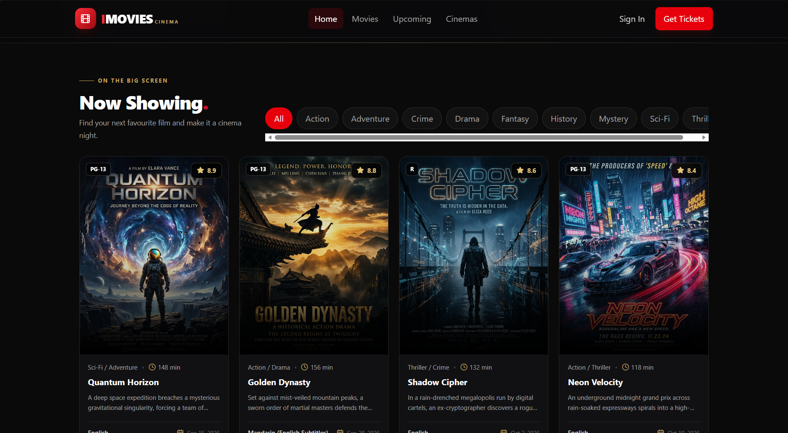
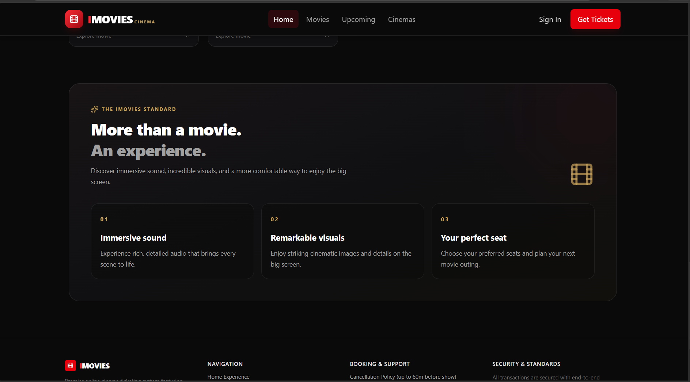
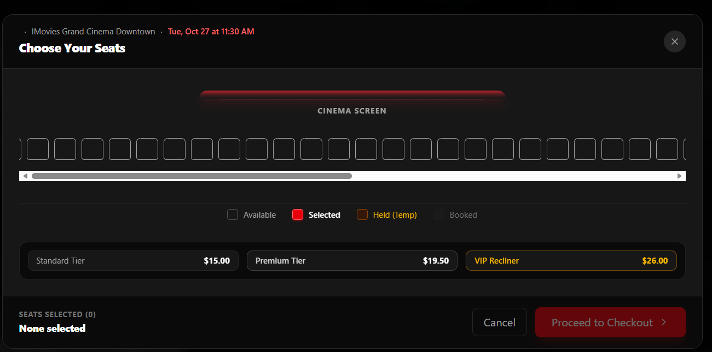
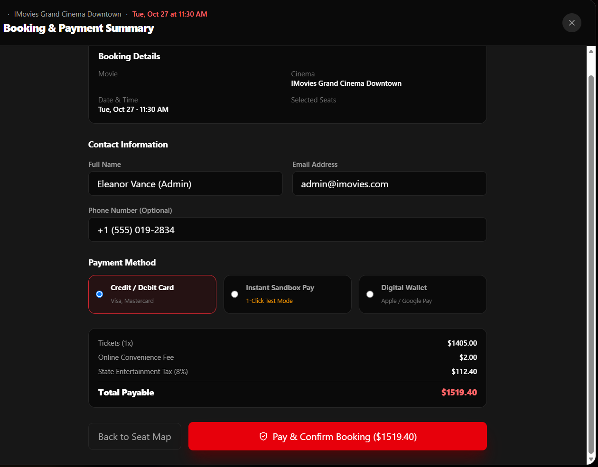
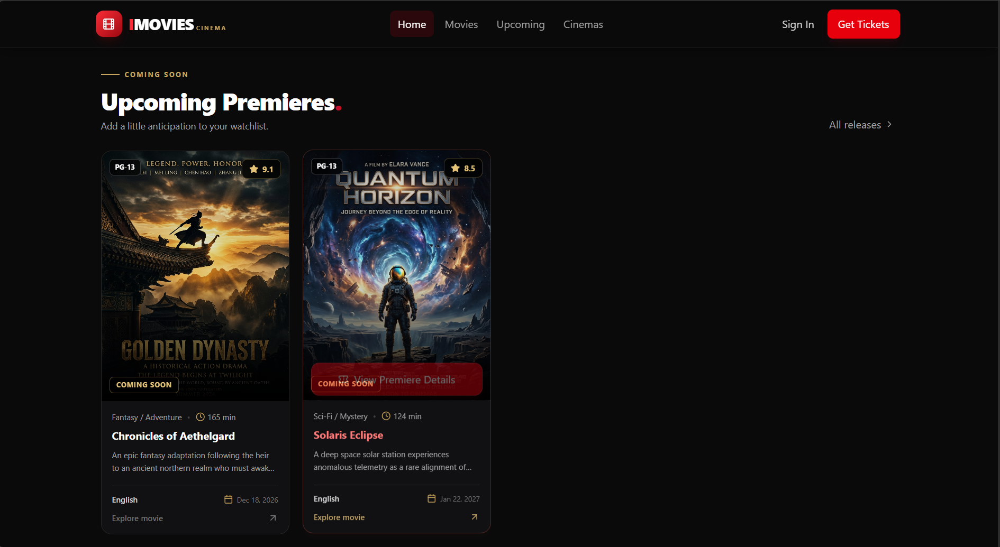

# IMovies — Cinema Ticket Booking System

## Overview

IMovies is a full-stack cinema ticket booking and management platform that enables users to browse movies, explore showtimes, select seats, and reserve tickets through an intuitive interface. Built using React.js, Node.js, Express.js, and MongoDB, the application provides movie discovery, user authentication, booking management, and cinema administration features.

## Key Features

- Browse movies and view movie details.
- Search and filter movies by available criteria.
- Explore showtimes and theatre listings.
- Select seats and view seat availability.
- Register, log in, and manage user accounts.
- Manage ticket bookings and booking history.
- Provide administration features for cinema management.
- Responsive user interface with a cinematic design.

## Technology Stack

**Frontend**
- React.js
- TypeScript / JavaScript
- HTML5 and CSS3
- Tailwind CSS and Lucide React icons

**Backend**
- Node.js
- Express.js
- REST APIs

**Database and Security**
- MongoDB
- Authentication and authorization
- Environment-based configuration

**Development Tools**
- Visual Studio Code
- Git and GitHub
- Postman for API testing

## Project Structure

```text
IMovies/
├── src/
│   ├── components/
│   ├── pages/
│   ├── services/
│   ├── context/
│   └── types/
├── public/
├── server.ts
├── package.json
├── package-lock.json
├── index.html
└── README.md
```

*The exact structure may vary depending on the current project files.*

## Installation and Setup

### Prerequisites

- Node.js and npm
- MongoDB, if required by the configured backend
- Git

### 1. Clone the repository

```bash
git clone YOUR_GITHUB_REPOSITORY_URL
cd IMovies
```

### 2. Install dependencies

```bash
npm install
```

If the project requires separate frontend and backend installation steps, follow the corresponding package configuration.

### 3. Configure environment variables

Create a local `.env` file using the environment variables required by the application. Do not commit credentials or secrets.

### 4. Start the application

Use the scripts defined in `package.json`. For a project configured with a Vite development server, run:

```bash
npm run dev
```

## Testing

Test the application workflows, including:

- User registration and login
- Movie listing and filtering
- Showtimes and seat selection
- Booking creation and confirmation
- API responses and error handling
- Responsive layout and navigation

## Future Enhancements

- Online payment gateway integration
- Real-time seat updates
- Booking cancellation and refunds
- Email and push notifications
- Advanced analytics for administrators
- Performance optimization and database indexing

## Skills Demonstrated

React.js, JavaScript, TypeScript, Node.js, Express.js, MongoDB, REST APIs, authentication, database management, responsive UI design, and Git version control.

## Author

**Diya Soni**

## License

Add a license if you intend to distribute the project under specific reuse terms.
## Screenshots

### Home Page


### Now Showing Movies


### Upcoming Movies


### Movie Details and Showtimes


### Seat Selection


### Booking and Payment Summary


### Cinema Experience

